> 欢迎登入 Serial Port Kits(简称SPK)官网 www.gqspark.top 免费下载试用。 新版本 5.6 已发布！

   # **1 概述**

   Serial Port Kits（简称SPK）是一款串口通讯软件。与市面上其他同类软件不同的是其设计目标：化繁为简，体验至上。SPK 并不追求繁多的功能，追求的是对每一个功能的用户体验和 UI 细节的打磨。功能的可用性及稳定性是 SPK 的基础，在此基础上， SPK 更加注重的是用户使用体验和视觉体验，例如：用户是否能快速使用软件；配置参数是否方便快捷；是否能智能的对接收的数据进行正确精准的换行；是否能根据输出 log 快速找到异常点以提高 debug 效率；软件运行速度是否够快；UI 界面是否干净简洁但又不失表达等等。

   SPK 的 UI 是其亮点之一，采用了现代化的设计元素，但是为了保持极佳的性能，UI元素的使用上保持了克制，没有使用更耗性能的动画特性，在美观和性能上做了平衡。我想大多数人都梦寐以求一款颜值拉满又能高效 debug 的工具软件，SPK 也许是个不错的选择。

   **SPK 支持的功能如下：**

   1. 支持自动检测可用串口，不需要手动刷新
   2. 支持串口自动回连功能
   3. 支持串口参数配置，支持任意波特率配置
   4. 支持 ASCII 和 Hex 收发模式
   5. 支持自动添加换行
   6. 支持回显发送的数据
   7. 支持保存 log 到文件
   8. 支持实时输出 log 到文件，对于 log 量大的情况非常有用
   9. 支持时间戳显示
   10. 支持数据高亮显示，在快速定位问题时非常有用
   11. 支持多帧发送和单帧发送，支持记录用户配置的多帧数据，重启软件自动加载
   12. 支持记录历史发送数据
   13. 支持定时发送
   14. **支持 7 种精美皮肤，不需要重启即可秒换肤。**
   15. 支持中英文
   16. **支持 6 种文件传输协议**
   17. 支持长时间采集波形数据并实时绘制波形数据，**百万级波形数据绘制依然流畅**
   18. **支持保存波形数据到 CSV 格式，支持 CSV 回放**
   19. **支持波形数据测量和统计学分析**
   20. **集成 Lua 脚本引擎，赋能任意协议解析，助力协议数据的多方位展示；同时也能实现自动化测试。系统内置了很多即插即用的 Lua 脚本 demo。**
   21. **集成帧组装器，支持定义任意协议格式，快速生成协议帧**
   22. 自动检测软件新版本，安静的提示用户更新

   # **2 软件展示**

   ## **2.1 皮肤**

   7种专业主题可供选择

   - 实验室试验台主题 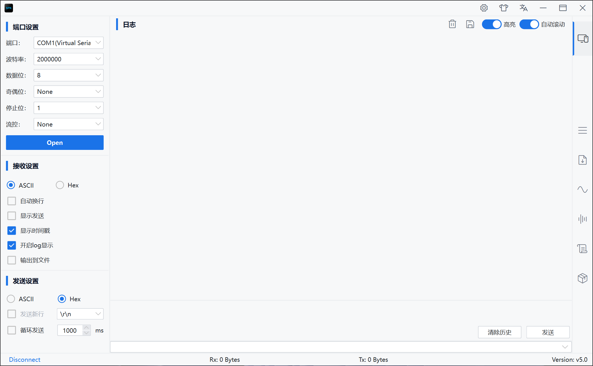
   - 暖色终端主题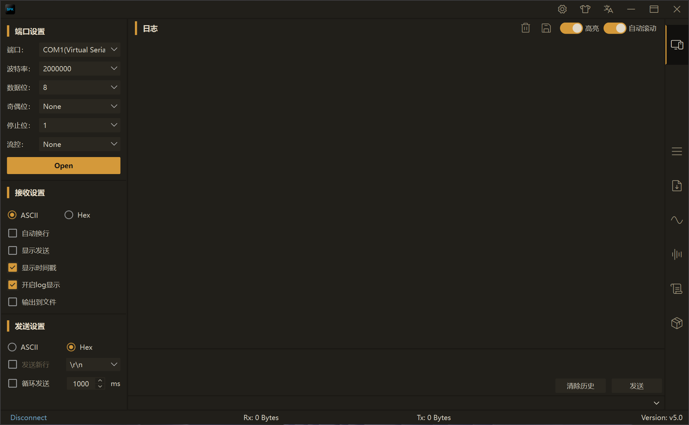
   - 午夜信号主题  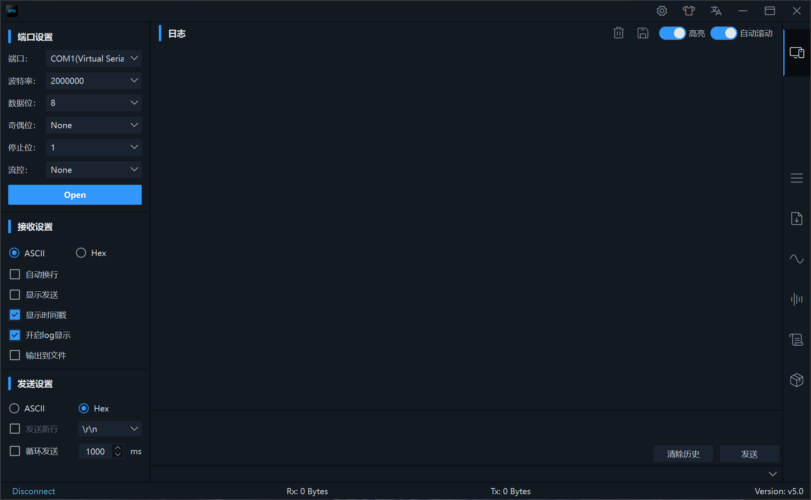
   - 森林实验室主题 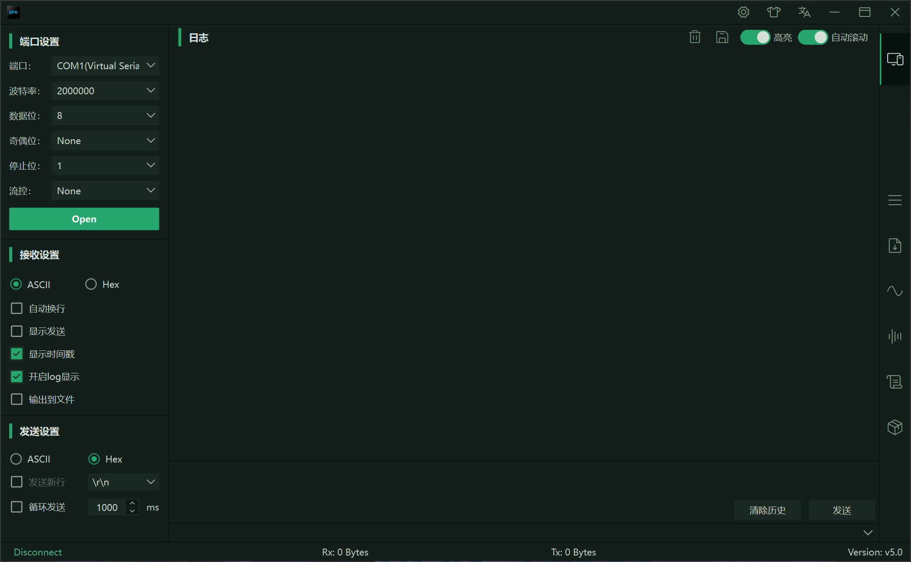
   - 金典暗色主题 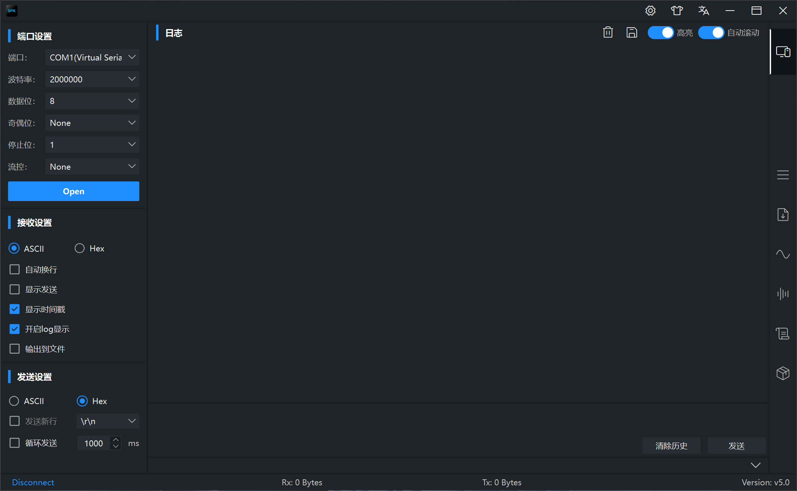
   - 深紫主题 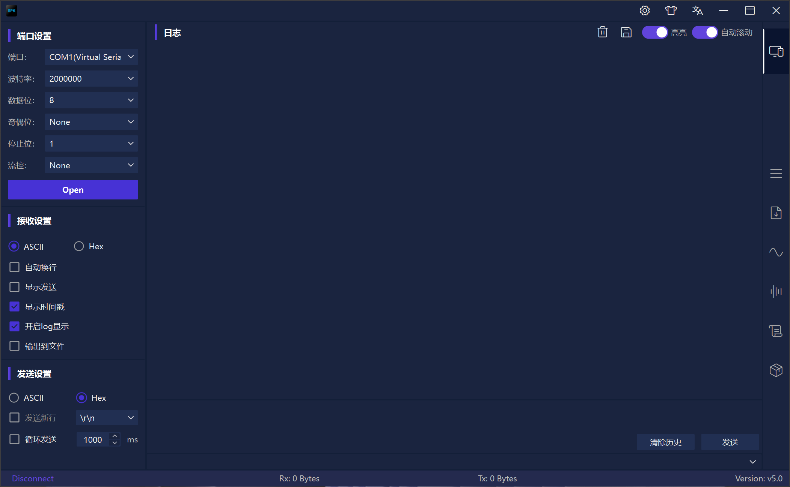
   - 翠绿主题 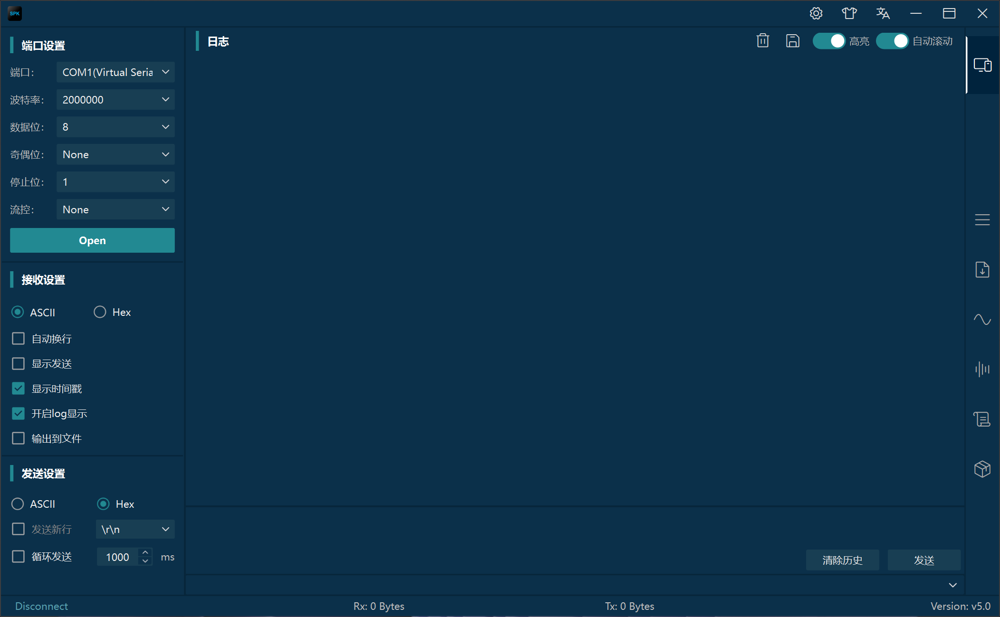

   ## **2.2 功能展示**

   - 数据高亮显示，bug无所遁形 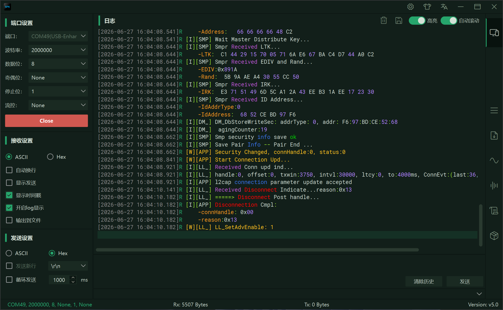

   - 多帧定时发送，实现自动化测试；记录用户配置，一次编辑永久使用；实时追踪当前帧，让用户感知当前状态。 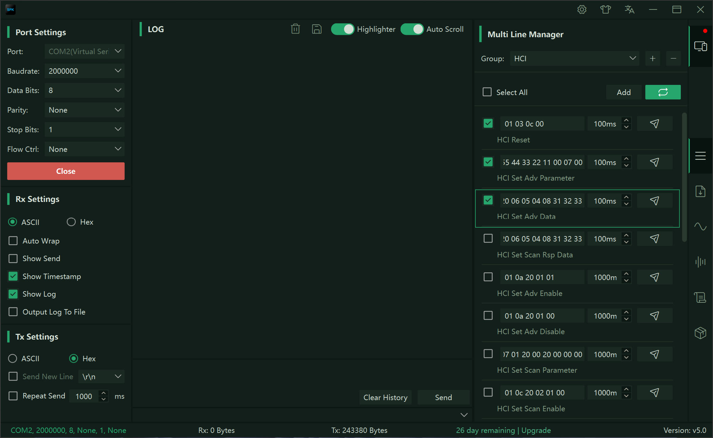

   - 6种常用的文件传输协议随便选 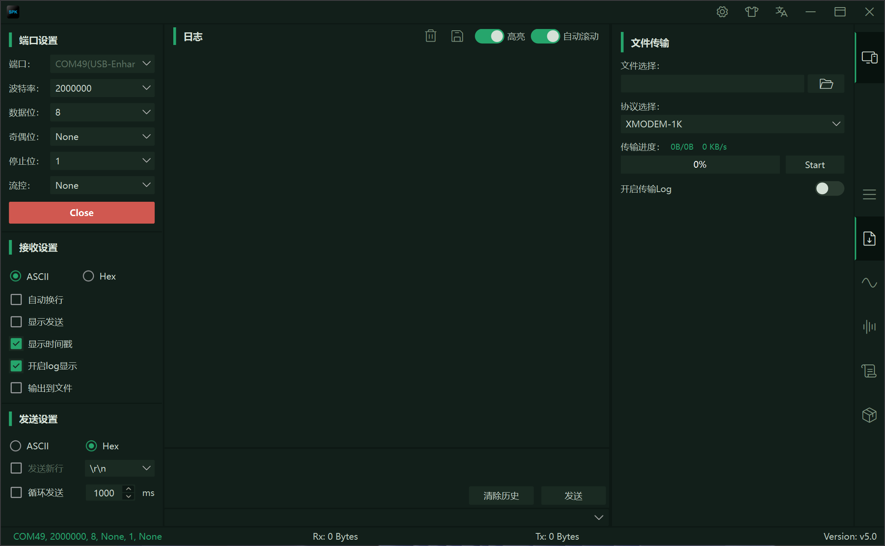

   - 百万级波形数据实时绘制，助你实时监测数据变化；保存数据到CSV格式，方便分发，有助于协同调试 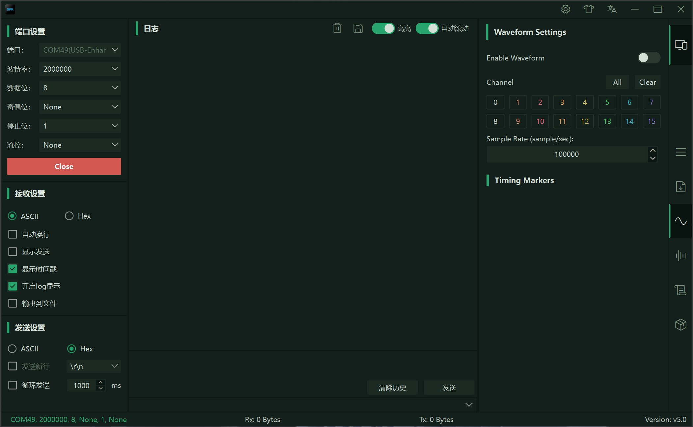

     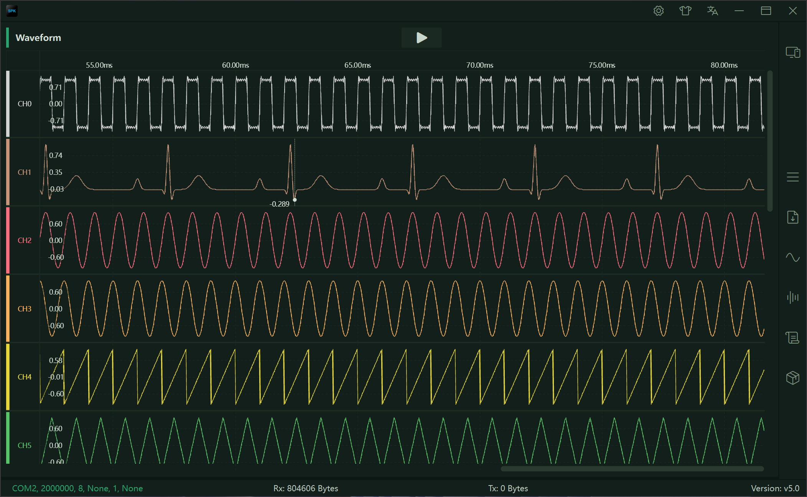

   - 数据测量和统计学计算，让数据更有价值 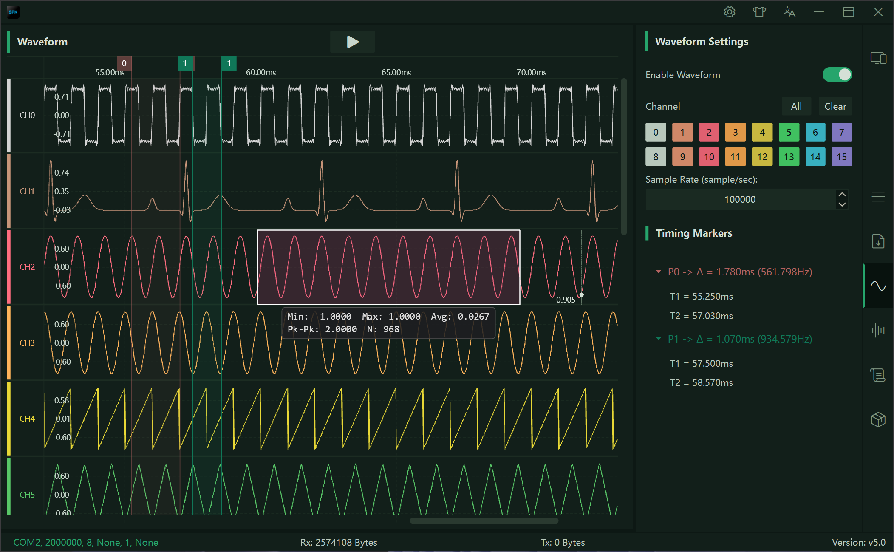

   - 10种常用波形数据发生器，生成模拟测试数据不在求人 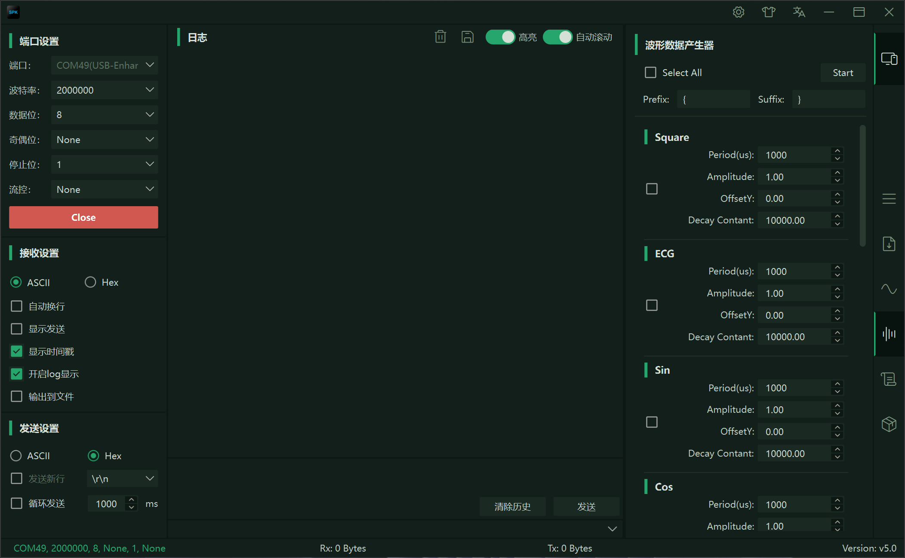

   - 集成 Lua 脚本引擎，赋能任意协议解析，助力协议数据的多方位展示，同时支持自动化测试。内置很多 Lua 脚本demo， 即插即用，简单方便。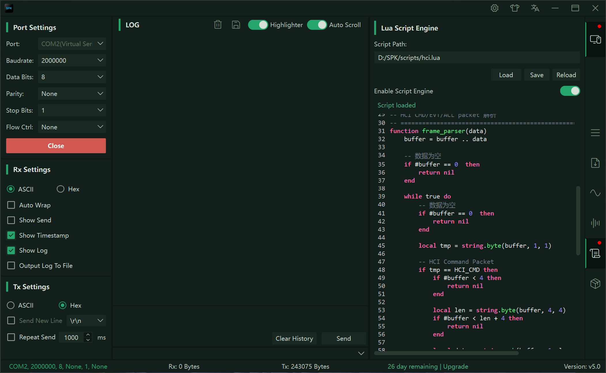

   - 集成帧组装器，支持定义任意协议格式，快速生成协议帧 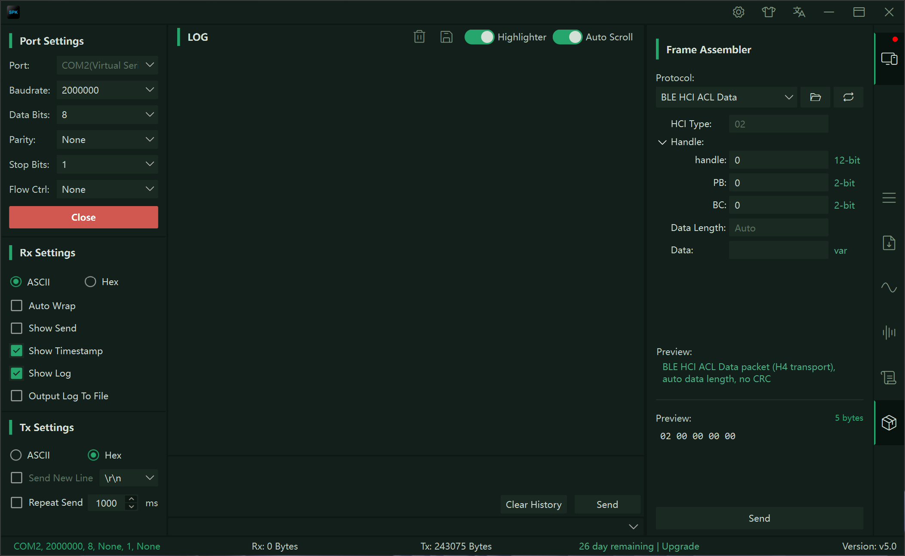
